# HireReel · video job applications

[](https://github.com/gayatripatel10091992/hirereel-video-jobs/actions/workflows/ci.yml)


A recruitment app where candidates swipe through **recruiter intro videos**, then apply by recording a short
**one-way video interview** with CameraX. Answers upload in the background with WorkManager, in resumable chunks.

It's modelled on the kind of app I built at Siyana (a 50K+ download hiring app): CameraX video recording,
auto-playing video with ExoPlayer, SMS Retriever OTP, WorkManager jobs, MVVM with Koin, and the memory work that
video-heavy apps need on low-end phones.

> Portfolio project. Original code; companies are fictional and the feed clips are Google's public sample videos.

## Screenshots

Rendered by Robolectric + Roborazzi in CI on every push. Camera and video surfaces can't render on the JVM,
so the gradient poster frames (what users see while a clip buffers) appear instead.

| Sign in (OTP) | Video feed | Search | Filters (dark) | Job detail |
|---|---|---|---|---|
| 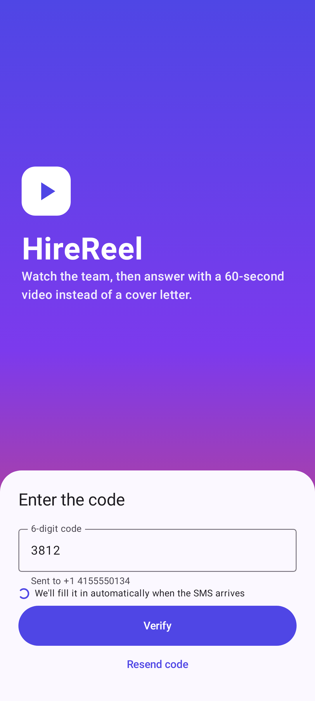 | 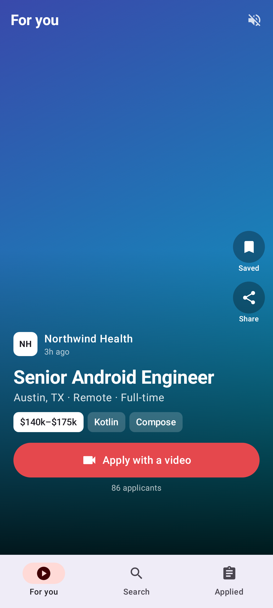 | 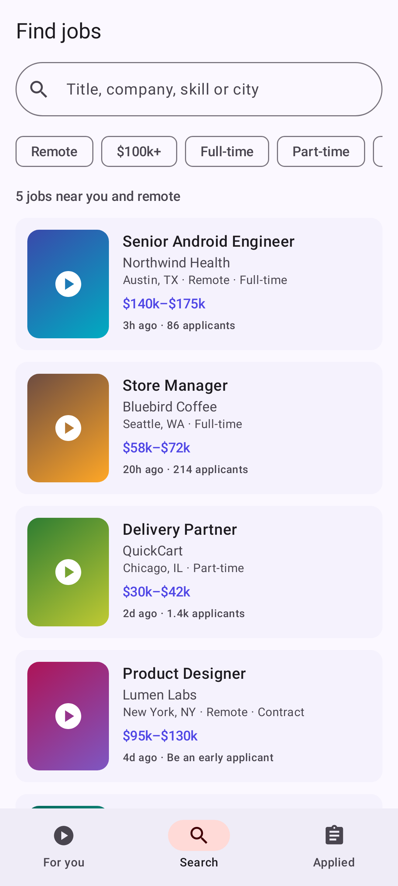 | 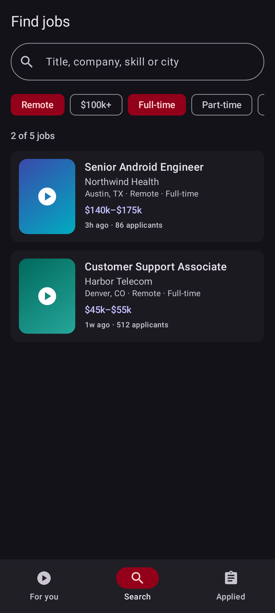 | 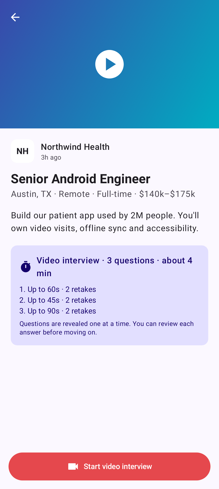 |

| Interview: ready | Recording | Review & retake | All answers | Uploads |
|---|---|---|---|---|
| 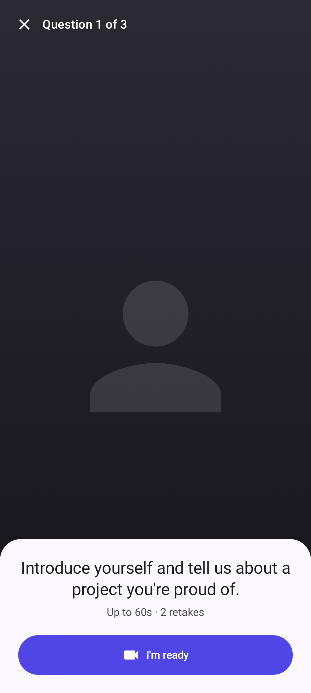 | 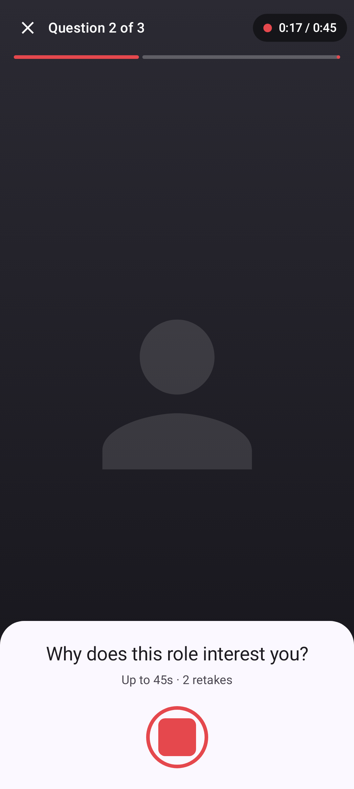 | 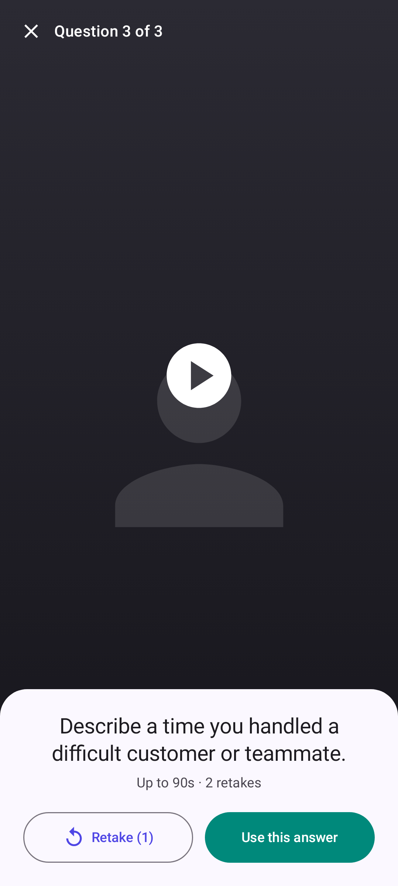 | 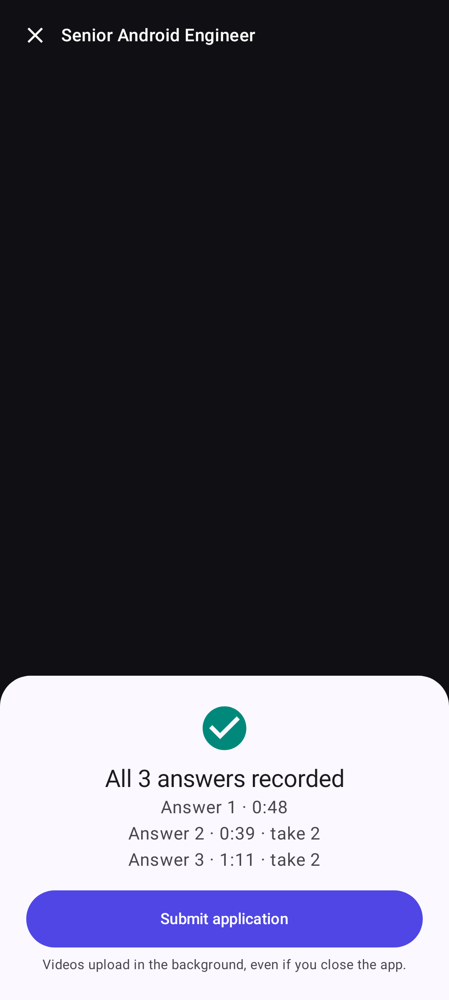 | 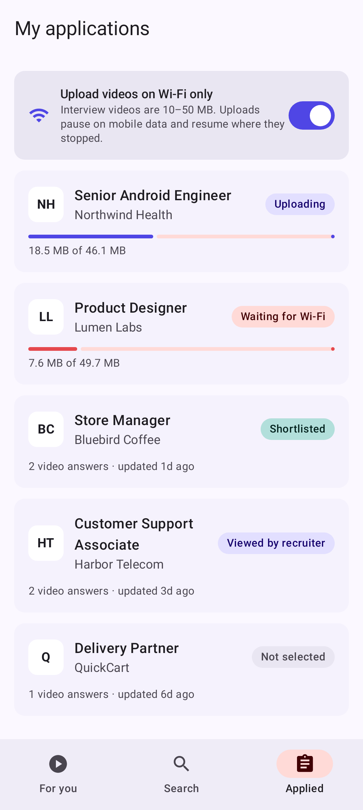 |

## Highlights

| Area | What's in the code |
|---|---|
| **Auto-play video feed** | `VerticalPager` + a `PlayerPool` of at most three ExoPlayers chosen by `PlayerPoolPolicy`: the settled page plays muted on loop, its neighbours pre-buffer, everything else is released. Nothing plays mid-swipe, players pause on `ON_STOP`, and short buffers (`DefaultLoadControl`) keep memory flat however far you scroll. |
| **CameraX video interview** | `InterviewCamera` binds Preview + `VideoCapture<Recorder>` on the front camera, records at SD with a fallback strategy and unbinds as soon as the screen leaves, to keep camera memory low. `InterviewSession` (pure Kotlin) drives prep countdown, a timed answer that auto-stops at the limit, review, and limited retakes. |
| **Background uploads** | `UploadWorker` (`CoroutineWorker`) sends 1 MB chunks and resumes from the last byte the server confirmed (`ChunkPlanner`). Constraints follow the user's *Wi-Fi only* setting, with exponential backoff, and only server or network errors are retried (`RetryPolicy`). The UI shows *Waiting for Wi-Fi* while constraints aren't met. |
| **OTP sign-in** | SMS Retriever API reads the code without the SMS permission; `OtpParser` ignores other numbers in the message. |
| **Architecture** | MVVM, Koin modules (view models with parameters via `parametersOf`), StateFlow UI state, stateless screens tested by screenshot, and a pure `core` module with 11 JVM tests. |

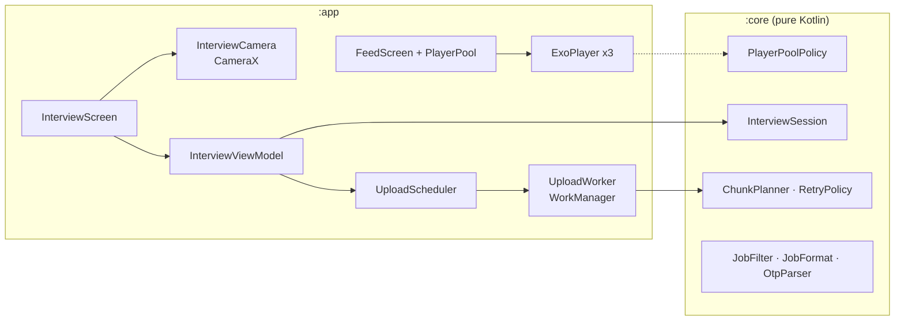

## Build

```bash
./gradlew :core:test                 # player pool, interview flow, chunking/backoff, filters, OTP
./gradlew :app:recordRoborazziDebug  # renders the screenshots
./gradlew assembleDebug
```

JDK 17. The upload API is simulated (`FakeUploadApi`), so the full flow works offline apart from streaming the feed clips.

## License

MIT
